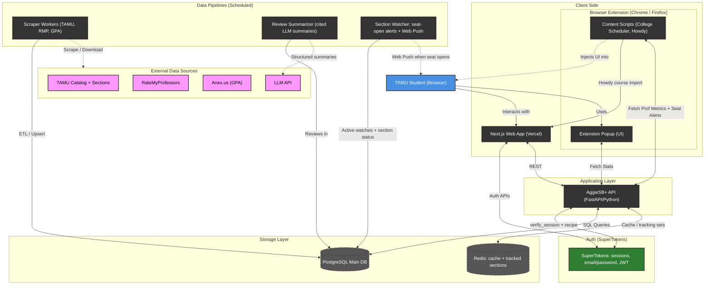

# AggieSB+ Backend

[](https://cronitor.io)
[](https://cronitor.io)
[](https://cronitor.io)
[](https://cronitor.io)

FastAPI service and data pipelines behind AggieSB+ (Aggie Schedule Builder Plus), a course and professor research tool for Texas A&M students. It combines official grade distributions, RateMyProfessors reviews and section data into one API.

- Live site: https://aggieschedulebuilderplus.vercel.app
- Public API: https://api-aggiesbp.nitheeshk.com (interactive docs at `/docs`)
- Frontend (Next.js): https://github.com/nitheesh-cpu/AggieSBP-Frontend
- Browser extension (Chrome/Firefox, for TAMU's registration site): https://github.com/nitheesh-cpu/AggieSBP-Extension

Data currently in the database (from the `/data_stats` endpoint on a local copy, last refreshed 2026-11-01): 6,288 professors, 5,651 courses, 140,935 sections, 97,236 RateMyProfessors reviews and 163,613 grade-distribution records.

## What it does

- Course, professor, section and term APIs, with search and side-by-side comparison of courses and professors.
- Official grade distributions (from Anex) next to RateMyProfessors ratings and reviews.
- LLM-written professor and per-course review summaries with structured fields (TL;DR, tips, review stats) and citations back to individual reviews.
- Discover endpoints: departments by term, core-curriculum (UCC) courses, GPA boosters, per-professor easiness and confidence scores.
- "Fit my schedule": given a student's existing schedule blocks, find sections of candidate courses that do not conflict.
- Prerequisite and corequisite trees for courses, which the schedule builder uses to show only electives a student can take.
- Seat alerts: users track sections and get a Web Push notification when a seat opens.
- Accounts (SuperTokens), saved schedules and per-user planner storage.

## Architecture



The API is a single FastAPI app (`src/aggiermp/api/main.py`) plus routers for discover, professors, prerequisites, planner and users. Reads go to PostgreSQL through SQLAlchemy, with raw SQL where a query is complex. Responses are cached in Redis. Scheduled pipelines scrape the TAMU catalog, section listings, Anex grade data and RateMyProfessors into Postgres. A separate section-watcher job compares section open status against users' tracked sections and sends push notifications. The web app and the extension are both clients of the same API.

### Data sources

| Source | What it provides |
| --- | --- |
| TAMU Course Catalog | Departments, courses, descriptions and prerequisite text |
| Howdy class search | Terms, sections, meeting times, instructors and seat status |
| Anex.us | Historical grade distributions by course, section and professor |
| RateMyProfessors | Professor ratings and student reviews (College Station and Galveston) |

### Pipeline status

The scrapers and the seat-alert watcher run on a schedule in production, monitored with Cronitor:

| Pipeline | Status |
| --- | --- |
| Sections upsert |  |
| GPA upsert |  |
| Courses upsert |  |
| Sections watcher |  |

## Engineering highlights

- **Schedule-fit conflict detection in SQL.** `POST /discover/{term_code}/fit-sections` (`api/routers/discover.py`) sends the student's schedule as JSON, expands it with `jsonb_to_recordset` into day/time rows and joins it against candidate sections' meeting times in one query, instead of fetching sections per course. Seat status, campus and attribute filters are applied in the same query.
- **Matching professors across three sources.** Registrar, Anex and RateMyProfessors write names differently ("Last, First", "First Last", "SURNAME I"). `core/name_matching.py` parses each format, handles surname particles and compound surnames, normalizes accents and scores pairs 0 to 1 with a conservative threshold (initial plus surname counts as a strong match, a mismatched given name rejects). It is used by the API and by the review/summary pipeline.
- **Easiness score that tolerates missing data.** `calculate_easiness_score` blends average GPA (weight 0.5), RMP difficulty (0.3) and RMP rating (0.2). When a component is missing, the remaining weights are renormalized, so a professor with no grade history is scored from ratings alone instead of being capped. A separate log-scaled confidence score reflects how many reviews and graded students back the number. Duplicate professor rows from the fuzzy join are collapsed to the one with the strongest review data before scoring.
- **LLM summaries that cite their sources.** In `pipelines/professors/hierarchical_summarization`, reviews are cleaned, deduplicated, grouped by normalized course and given short local IDs (`r1`..`rN`). The model returns a strict-schema structured summary; `professor_request.py` maps citations back to real RMP review IDs and rejects any claim that cites an ID not in the request. Review statistics (would-take-again, grades, attendance) are computed in Python, not by the model. An optional verifier (TypeSafe) can check that claims are supported by their cited reviews, and a local embedding/HDBSCAN/BART path exists as a fallback when no LLM credentials are set.
- **Incremental review sync.** `pipelines/professors/review_sync.py` compares RMP's reported rating count per professor (fetched in bulk) against the local count, so a run only re-fetches reviews for professors whose count changed.
- **Caching tuned per endpoint.** `core/cache.py` provides a `@cached` decorator with TTL tiers from 5 minutes (stats) to 24 hours (catalog data) and an optional per-request TTL (shorter when filtering on seat status). `pipelines/prewarm_cache.py` warms core discover endpoints, and the app degrades to uncached responses if Redis is unavailable.
- **Prerequisite trees.** `pipelines/courses/prereq_parser.py` and `parse_prereqs.py` turn catalog prerequisite text into AND/OR trees with minimum grades and concurrent-enrollment flags; `GET /courses/prereqs` returns them for up to 100 courses and can follow references to a requested depth.
- **Seat alerts without N+1 queries or spam.** `collectors/section_watcher.py` fetches every watched section and its open status in one query, sends pushes from a thread pool, and records `last_notified_open_at` so a section that stays open does not re-notify.

## Tech stack

Python 3.10+, FastAPI, Uvicorn/Gunicorn, SQLAlchemy 2, PostgreSQL, Redis, SuperTokens, pywebpush, Pydantic, Playwright and BeautifulSoup for scraping, sentence-transformers / HDBSCAN / scikit-learn for the local summarization fallback, Scalar for API docs. Tooling: pytest, ruff, mypy, uv, GitHub Actions.

## Running locally

Requirements: Python 3.10+, PostgreSQL, Redis (optional; caching is skipped without it) and a SuperTokens core (default `http://localhost:3567`) for auth routes.

```bash
git clone https://github.com/nitheesh-cpu/AggieSBP-Backend.git
cd AggieSBP-Backend
python -m venv .venv
source .venv/bin/activate        # Windows: .venv\Scripts\activate
pip install -r requirements.txt  # or: pip install -e .
cp .env.example .env             # then fill in your values
python run_api.py                # http://localhost:8000, docs at /docs
```

Configuration is read from `.env` (see `src/aggiermp/core/config.py`). Main variables, by name:

- Database: `POSTGRES_HOST`, `POSTGRES_PORT`, `POSTGRES_DATABASE`, `POSTGRES_USER`, `POSTGRES_PASSWORD`, or a single `DATABASE_URL`
- Cache: `REDIS_URL`
- Auth: `SUPERTOKENS_CONNECTION_URI`, `SUPERTOKENS_API_KEY`, `SUPERTOKENS_API_DOMAIN`, `SUPERTOKENS_WEBSITE_DOMAIN`, `CORS_ORIGINS_EXTRA`
- Push: `VAPID_PRIVATE_KEY`
- Admin endpoints (`/cache/clear`): `ADMIN_API_KEY`
- Summarization: `TAMU_AI_*`, `SUMMARY_*`, `TYPESAFE_*` (documented in `.env.example`)

Apply the SQL files in `src/aggiermp/database/migrations/` and `pipelines/*/migrations/` to your database as needed.

Pipelines (run from the repo root):

```bash
python -m pipelines.courses.upsert_courses
python -m pipelines.sections.upsert_all
python pipelines/gpa/upsert_gpa_data.py
python -m pipelines.professors.upsert_all                          # professors, reviews, summaries
python -m pipelines.professors.upsert_all --university-id 1006     # Galveston campus
python -m aggiermp.collectors.section_watcher                      # one seat-alert pass
```

Professor imports cover College Station (RMP school 1003) and Galveston (1006); each campus is stored as its own university.

## Project layout

```
src/aggiermp/
  api/            FastAPI app (main.py) and routers: discover, professors, prereqs, planner, users
  core/           config, Redis cache, professor name matching, push helpers
  database/       SQLAlchemy models/session and SQL migrations
  collectors/     section_watcher (seat alerts)
  models/         Pydantic schemas
pipelines/
  courses/        catalog scraping, prerequisite parsing, upsert
  sections/       section scraping and upsert
  gpa/            Anex grade-distribution scraping and upsert
  professors/     RMP scraping, review sync, upsert, hierarchical_summarization/
  prewarm_cache.py
tests/            pytest suite
```

## Testing

```bash
pip install pytest pytest-asyncio httpx
pytest
```

Pure-function tests (for example `test_easiness_score.py`) do not touch the database. The API tests (`test_api_endpoints.py`, `test_planner_api.py`, `test_prereq_api.py`, `endpoints_test.py`) import the app and expect a reachable PostgreSQL database configured through the `POSTGRES_*` variables. CI (`.github/workflows/ci.yml`) runs ruff, pytest against a Postgres service, mypy and a dependency scan.

## License

MIT. See `LICENSE`.
