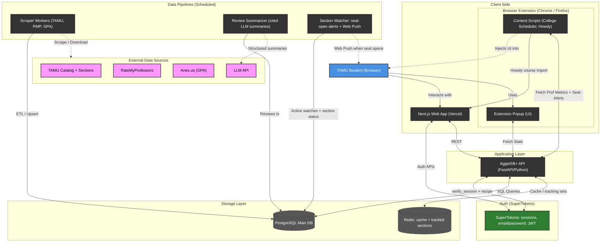

# AggieSB+ Backend

[](https://cronitor.io)
[](https://cronitor.io)
[](https://cronitor.io)
[](https://cronitor.io)

The API and data pipelines behind [AggieSB+](https://aggieschedulebuilderplus.vercel.app), a course and professor lookup tool for Texas A&M students.

**API docs:** https://api-aggiesbp.nitheeshk.com/docs · **Frontend:** [AggieSBP-Frontend](https://github.com/nitheesh-cpu/AggieSBP-Frontend) · **Extension:** [AggieSBP-Extension](https://github.com/nitheesh-cpu/AggieSBP-Extension)

~6.3k professors · 5.6k courses · 140k sections · 97k reviews · 163k grade records

## What's in here

- Course, professor and section APIs with search and compare
- Grade distributions and RateMyProfessors reviews side by side
- AI review summaries that cite the reviews they came from
- Easiest core classes, GPA boosters, and "fit my schedule" (find sections that don't conflict)
- Prerequisite trees for the schedule builder
- Seat alerts over Web Push

## Architecture



## Pipelines

| Pipeline | Status |
| --- | --- |
| Sections upsert |  |
| GPA upsert |  |
| Courses upsert |  |
| Sections watcher |  |

| Source | Data |
| --- | --- |
| TAMU Course Catalog | Courses, descriptions, prerequisites |
| Howdy class search | Sections, meeting times, instructors, seats |
| Anex.us | Grade distributions |
| RateMyProfessors | Ratings and reviews (College Station + Galveston) |

## Stack

Python, FastAPI, PostgreSQL, Redis, SQLAlchemy, SuperTokens, Playwright, pywebpush. CI runs ruff, mypy and pytest.

## Run it locally

You need Python 3.10+, Postgres, and optionally Redis and a SuperTokens core.

```bash
git clone https://github.com/nitheesh-cpu/AggieSBP-Backend.git
cd AggieSBP-Backend
pip install -r requirements.txt
cp .env.example .env   # fill in your DB, Redis and SuperTokens settings
python run_api.py      # http://localhost:8000/docs
```

Pipelines:

```bash
python -m pipelines.courses.upsert_courses
python -m pipelines.sections.upsert_all
python pipelines/gpa/upsert_gpa_data.py
python -m pipelines.professors.upsert_all
python -m aggiermp.collectors.section_watcher
```

## Layout

```
src/aggiermp/api/          FastAPI app and routers
src/aggiermp/core/         config, cache, name matching, push
src/aggiermp/collectors/   seat-alert watcher
pipelines/                 scrapers + upserts (courses, sections, gpa, professors)
tests/                     pytest
```

MIT License
